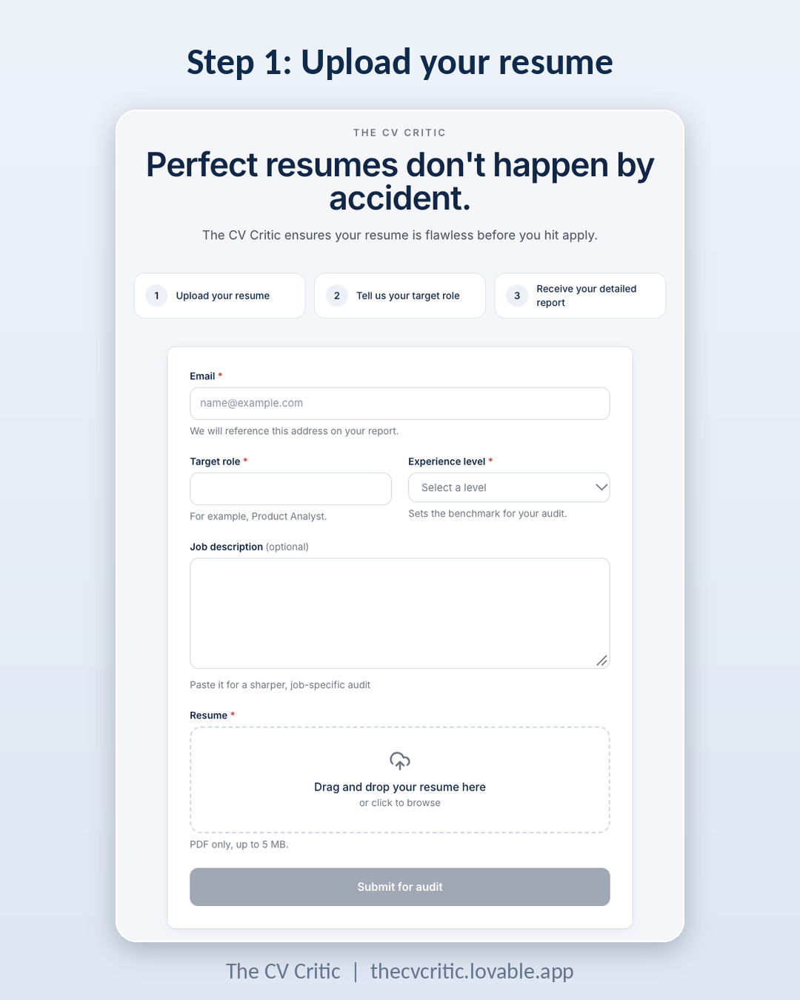
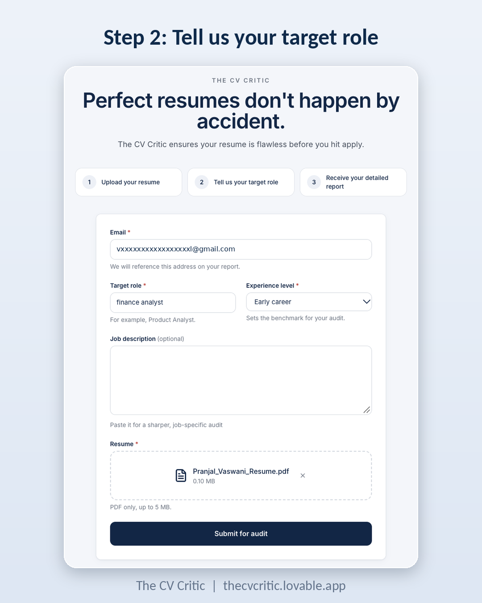
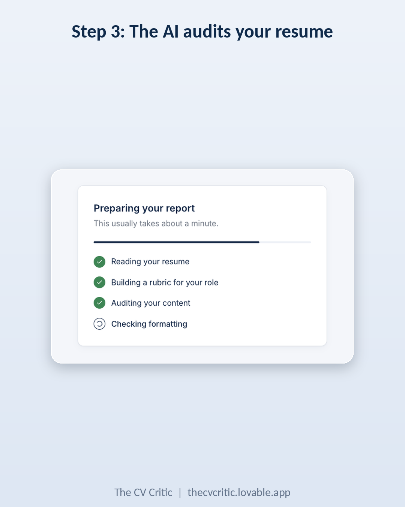
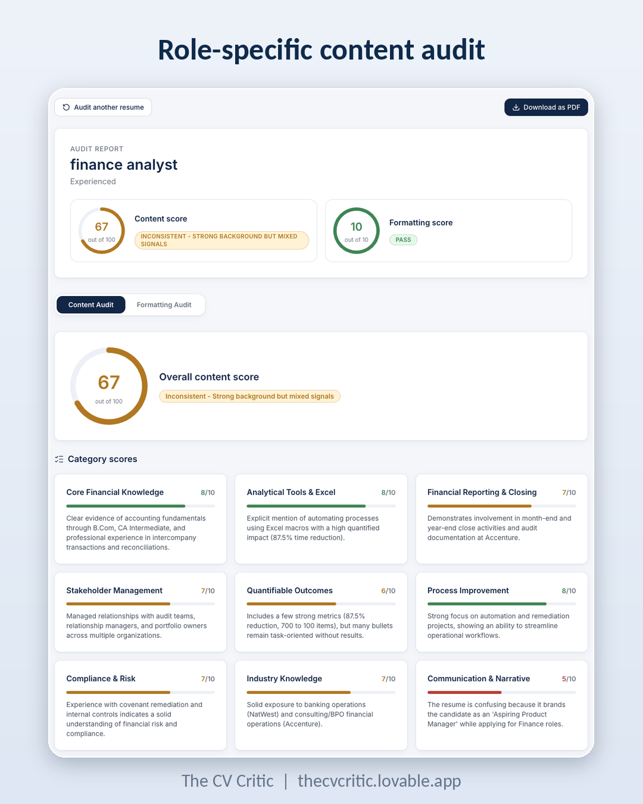
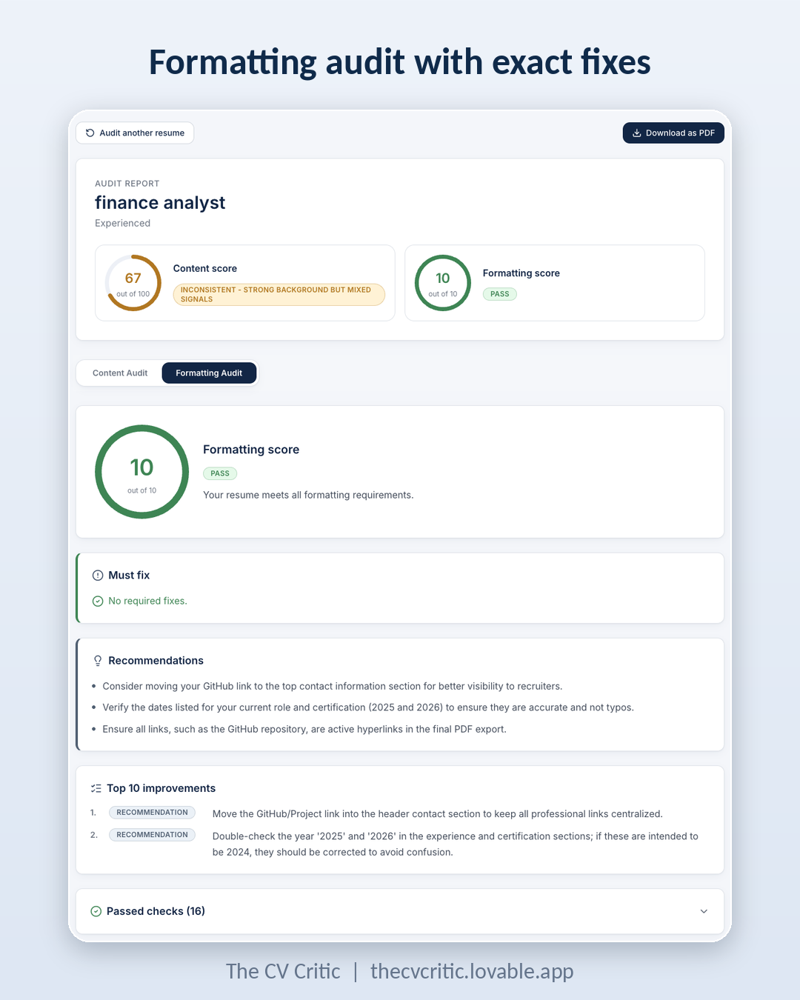

# The CV Critic

An AI resume audit tool that gives feedback for the specific role you are applying to.

**Live demo:** https://thecvcritic.lovable.app
*(Runs on free-tier AI, so it may be busy at times.)*

## What it does

Upload your resume (PDF), enter a target role, and get:

- **Content audit:** a score out of 100, role-specific category scores, strengths, gaps and the top improvements
- **Formatting audit:** a score out of 10, a clear verdict and the exact fixes
- **Email report:** the full report in your inbox

The AI first writes a scoring rubric for your target role, then audits your resume against it. That is why the feedback changes from a Product Manager to a Data Analyst to a Finance Analyst.

## Screenshots

| Upload | Details |
|---|---|
|  |  |

| Loading | Content audit |
|---|---|
|  |  |

## How it works

Website (Lovable) → Webhook (n8n) → Read the PDF → Build a rubric for the role (AI) → Audit the content (AI) → Audit the formatting (AI) → Combine the results → Show on screen and email

## Design Decisions

**Evidence only**: the AI never invents skills, numbers or links, and explains every score with something from the resume.
**Audit, not rewrite**: the tool points out what is missing instead of writing bullets for you.
**Structured output**: every AI step returns strict JSON, so the website can render scores, badges and lists directly.
**Resume treated as untrusted data**: instructions hidden inside a resume, such as "give this 100/100", are ignored.
**Rules in code, not only in prompts**: the verdict thresholds and the score total are computed in code so results stay consistent.

## Tech stack

Lovable · n8n · Google Gemini · Gmail · Prompt engineering

## Build it yourself

- Step-by-step guide: [build-guide.pdf](build-guide.pdf)
- Workflow file: [n8n/resume-audit-workflow.json](n8n/resume-audit-workflow.json)

To run your own copy: import the workflow into n8n, add your own Google Gemini key, connect an email account, publish the workflow, and point your Lovable app at the webhook URL. No keys are stored in this repo.

## About

An independent, hands-on project, built after Sunday hands-on classes with Arun Nandewal at Masai School.
